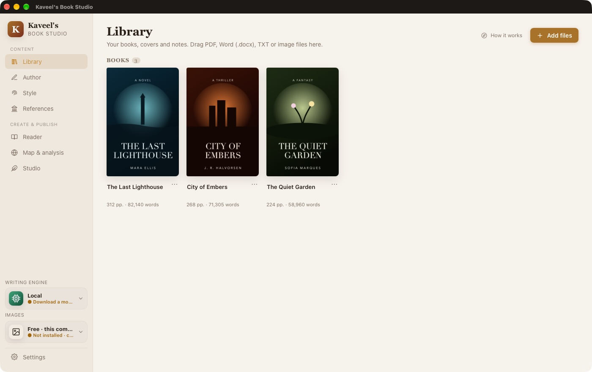
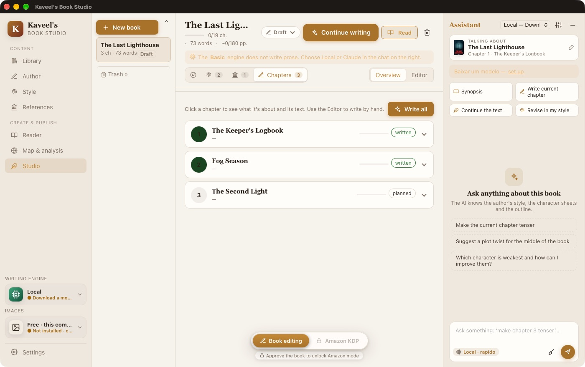

# Kaveel's Book Studio

A free writing studio for any writer (macOS + Windows, built with Tauri 2 + Rust + TypeScript). Start a book from scratch with just an idea, or bring in the books you have already written and keep going in your own style. When it is done, publish it on Amazon KDP.

It was first made for author Kaveel Lilmohun, and now works for any writer and genre.




## Features
- **Library**: every book with its cover, status and quick actions.
- **Studio**: an editor with chapters, characters, an idea board, a story map and analysis. A switch flips between **Edit mode** and **Amazon (KDP) mode**.
- **AI writing (optional)**: Claude (through your logged-in Claude Code), ChatGPT or Gemini. The chat always works on the book that is open.
- **Style**: an analysis of your voice, vocabulary, characters and structure, plus a checker for new text.
- **KDP export**: EPUB, full-wrap cover (PNG/PDF/layered PSD) and all the listing metadata.
- **Reader**, references, a light/dark/custom theme and an English/Portuguese UI.

All data stays on your computer. API keys are stored locally and never leave the app.

## Download

**macOS (Apple Silicon)**
```bash
curl -L -o ~/Downloads/KaveelsBookStudio.dmg https://github.com/matthfaria96/kaveels-book-studio/releases/latest/download/KaveelsBookStudio-mac.dmg && open ~/Downloads/KaveelsBookStudio.dmg
```
Drag the app to Applications. The app is not signed, so the first time run:
```bash
xattr -cr "/Applications/Kaveel's Book Studio.app"
```

**Windows (PowerShell)**
```powershell
iwr https://github.com/matthfaria96/kaveels-book-studio/releases/latest/download/KaveelsBookStudio-windows-setup.exe -OutFile $env:TEMP\kbs.exe; & $env:TEMP\kbs.exe
```

Or get the files from the [Releases page](https://github.com/matthfaria96/kaveels-book-studio/releases).

## Build from source
Requirements: Node 20+ and Rust (stable).
```bash
npm install
npm run app          # dev mode
npx tauri build      # installer in src-tauri/target/release/bundle
```
On macOS, `npm run install_app` builds and installs the app into /Applications.

Data folder: `~/Library/Application Support/app.kaveels.bookstudio` (macOS) or `%APPDATA%\app.kaveels.bookstudio` (Windows).

## License
MIT
